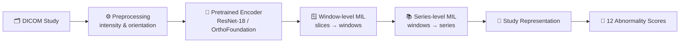

<div align="center">

# 🦴 RSNA Knee Abnormality Detection

### Hierarchical Multiple Instance Learning on Knee MRI with Foundation-Model Embeddings


-2E8B57)


**[Competition](https://www.kaggle.com/competitions/rsna-knee-abnormality-detection)** ·
**[OrthoFoundation](https://github.com/ytrsk/OrthoFoundation)** ·
**[DINOv3 Paper](https://arxiv.org/abs/2508.10104)** ·
**[Attention-MIL Paper](https://proceedings.mlr.press/v80/ilse18a.html)**

<br>

| 🏆 Best Macro ROC-AUC | 🧠 Backbone | 🎯 Targets | 🗂️ Training Studies |
|:---:|:---:|:---:|:---:|
| **0.8168** | OrthoFoundation (DINOv3) | 12 abnormalities | 4,407 |

</div>

---

## 📑 Table of Contents

1. [Problem Overview](#-problem-overview)
2. [Dataset & Challenges](#-dataset--challenges)
3. [Methodology](#-methodology)
4. [Experimental Results](#-experimental-results)
5. [Evaluation](#-evaluation)
6. [Repository Structure](#-repository-structure)
7. [Technologies](#-technologies)
8. [References](#-references)

---

## 🩻 Problem Overview

The goal is to build a model that identifies clinically relevant abnormalities from **knee MRI examinations**.

This is a **study-level, multi-label classification** problem. Each MRI study contains multiple imaging series, each series consists of many DICOM slices, and a single study may show several abnormalities at once.

The model predicts a confidence score for each of **12 target abnormalities**:

| Category | Targets |
|---|---|
| 🦵 **Ligaments & Menisci** | ACL injury · MCL injury · Medial meniscus tear · Lateral meniscus tear |
| 🦴 **Osteoarthritis** | Medial compartment OA · Lateral compartment OA · Patellofemoral OA |
| 🔍 **Other Findings** | Effusion · Synovitis · Baker's cyst · Contusion · Fracture |

---

## 📊 Dataset & Challenges

| Dataset component | Count |
|---|---:|
| Training studies | **4,407** |
| Training series | **24,371** |
| Studies with complete official labels | **58** |

Complete expert-labelled data is scarce, so labels for additional training studies were **derived from their radiology reports**.

### ⚠️ Key challenges

- 🏷️ **Weak supervision** and noisy, report-derived labels
- 🧩 **Aggregation** of information across multiple MRI series and slices
- 🔬 **Study-level prediction** from slice-level visual representations
- ⚖️ **Class imbalance** and varying abnormality prevalence
- 🧪 **Evaluation** on a very small expert-labelled subset

---

## 🧬 Methodology

The project explores **hierarchical representation learning** and study-level prediction.



**Pipeline stages**

1. **DICOM preprocessing**: load MRI slices, handle intensity and orientation-related variation, and prepare model inputs.
2. **Feature extraction**: extract visual representations with pretrained image encoders.
3. **Hierarchical aggregation**: aggregate across MRI windows and series to build study-level representations.
4. **Multi-label prediction**: predict the 12 abnormality targets.

### 🔬 Approaches explored

| # | Experiment | Approach |
|:-:|---|---|
| 1 | **Baseline** | ResNet-18 embeddings with hierarchical MIL |
| 2 | **Foundation model** | OrthoFoundation (DINOv3) embeddings with window–series hierarchical MIL |
| 3 | **Task-specific learning** | Independent abnormality-specific classifiers |

---

## 📈 Experimental Results

| Configuration | Macro ROC-AUC | |
|---|:---:|---|
| ResNet-18 + Hierarchical MIL | `0.7273` | `███████░░░` |
| **OrthoFoundation (DINOv3) + Hierarchical MIL** | **`0.8168`** | `████████░░` |

> 🚀 Switching to OrthoFoundation (DINOv3) embeddings improved Macro ROC-AUC by roughly **+0.09** over the ResNet-18 baseline.

> [!NOTE]
> These results are **indicative, not a strictly controlled comparison**: the experimental configurations and validation setups differed between runs. Independent abnormality-specific classifiers were also explored, but their results are not included here as a directly comparable benchmark.

---

## ✅ Evaluation

- 🏁 **Competition metric:** macro-averaged ROC-AUC across the 12 target abnormalities.
- 🩺 **Expert-labelled validation:** the 58 studies with complete official labels provide an expert reference for evaluation.

> [!WARNING]
> The 58-study validation subset is small, which limits the reliability of the resulting performance estimates.

---

## 🗂️ Repository Structure

```text
RSNA_Knee_abnormality/
│
├── 📄 README.md
│
├── 📓 first-notebook-rsna-knee.ipynb
├── 📓 orthofoundation-multihead-rsna-train.ipynb
├── 📓 orthofoundation-rsna-mil-train-pipeline.ipynb
└── 📓 rsna-knee-1-9455a3.ipynb
```

The notebooks cover data exploration, preprocessing, feature extraction, model development, and the experimental workflows.

---

## 🛠️ Technologies

| Area | Stack |
|---|---|
| **Programming** |  |
| **Deep Learning** |  |
| **Computer Vision** | ResNet-18 · DINOv3 / OrthoFoundation |
| **Medical Imaging** | DICOM |
| **Learning Paradigm** | Multi-label classification · Multiple Instance Learning |
| **Evaluation** | ROC-AUC |

---

## 📚 References

- 🏆 [RSNA Knee Abnormality Detection: Kaggle Competition](https://www.kaggle.com/competitions/rsna-knee-abnormality-detection)
- 🦴 [OrthoFoundation: GitHub Repository](https://github.com/ytrsk/OrthoFoundation)
- 🧠 [DINOv3: Research Paper](https://arxiv.org/abs/2508.10104)
- 🎯 [Attention-based Deep Multiple Instance Learning](https://proceedings.mlr.press/v80/ilse18a.html)

---

<div align="center">

**⚕️ Disclaimer:** This repository documents experimental work on medical image classification. Model predictions are research outputs and are **not intended for clinical diagnosis**.

</div>
